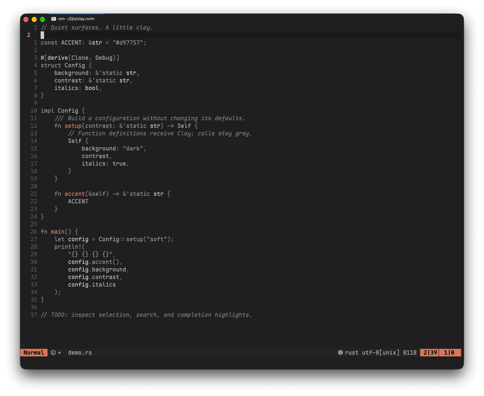

# clay.nvim

灰阶为底，陶土色点睛的 Neovim 深色主题。



默认透明背景，以 `#D97757` Clay 突出函数定义与操作焦点；语法、诊断、Diff 和 Git 状态以灰阶区分。关闭透明后，背景为 `#111315`。

需要 **Neovim 0.10.4+** 和支持真彩色的终端。

## 安装

使用 lazy.nvim：

```lua
{
  "DefectingCat/clay.nvim",
  version = "*",
  lazy = false,
  priority = 1000,
  opts = {},
  config = function(_, opts)
    require("clay").setup(opts)
    vim.cmd.colorscheme("clay")
  end,
}
```

上例安装最新稳定版。`v0.1.0` 使用旧名称 `claude`，升级前请参阅[迁移说明](CHANGELOG.md#v020---2026-10-16)。

## 配置

在 `opts` 中按需设置，以下为默认值：

```lua
opts = {
  accent = "restrained",
  transparent = true,
  italic_comments = true,
  bold_keywords = false,
  terminal_colors = true,
  palette = {},
  overrides = {},
}
```

| `accent`     | 函数定义 | 函数调用 | 操作焦点 |
| ------------ | -------- | -------- | -------- |
| `minimal`    | 亮灰     | 灰       | Clay     |
| `restrained` | Clay     | 灰       | Clay     |
| `expressive` | Clay     | Clay     | Clay     |

区分函数定义与调用需要 Tree-sitter 高亮或 LSP 定义标记。设置 `transparent = false` 使用实色背景；浮窗、状态栏与选区始终保留底色。

通过 `palette` 修改[色板](lua/clay/palette.lua)，通过 `overrides` 覆盖高亮。完整示例见 [`:help clay-options`](doc/clay.txt)。配置变更后执行 `:colorscheme clay` 生效。

## 插件适配

内置 Telescope、Snacks、nvim-cmp、blink.cmp、Neo-tree、Gitsigns、Noice、bufferline、mini.nvim 等插件高亮，完整列表见[帮助文档](doc/clay.txt)。

lualine 在主题配置后设置：

```lua
require("lualine").setup({ options = { theme = "clay" } })
```

nvim-scrollbar 需设置 `set_highlights = false`，nvim-navic 需设置 `highlight = true`。

## 预览

在仓库目录运行，使用独立配置：

```bash
make preview
CLAY_ACCENT=expressive make preview
```

多语言预览：

```bash
make preview-parsers
make preview FILE=examples/demo.py
```

Parser 准备工具需要 Neovim 0.12+、当前版 nvim-treesitter、tree-sitter CLI 0.26.1+、C 编译器、curl 和 tar。默认使用 `~/.local/share/nvim/lazy/nvim-treesitter`，可用 `CLAY_TREESITTER_DIR` 指定其他路径；生成文件位于 `.preview/site/`。

状态栏显示 `regex` 时表示未启用 Tree-sitter，具体原因见 `:messages`。更多选项见 [`:help clay-preview`](doc/clay.txt)。

## 验证

```bash
make test                  # 核心行为，需要 Lua Tree-sitter parser
make test-languages        # 九种语言，需先准备 parser
CLAY_PLUGIN_ROOTS="$HOME/.local/share/nvim/lazy" make test-plugins
```

测试使用独立 Neovim 进程；插件检查使用已有 checkout，缺失依赖显示 `SKIP`。

推送与 PR 自动运行 CI；推送版本标签后，检查通过即按变更日志生成 GitHub Release。

[更新日志](CHANGELOG.md) · [发布指南](RELEASING.md) · [使用文档](doc/clay.txt)

## 致谢

配色灵感来自 [Claude Design System](https://rua.plus/post/claude-design-system-style-and-motion)，灰阶层级参考 [lackluster.nvim](https://github.com/slugbyte/lackluster.nvim/tree/70dd682e564784893b984deb51dd5ddd263c8cc7)。本项目为独立社区主题。
